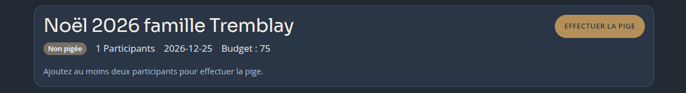
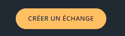

# Revue UI - 29 oct 2026

## Landing

### Blocs avec image (3)

- Revoir les images pour plus de clarté. Exemples:
  - Vie privée: oeil, serrure, silouhette de voleur (de cadeau?), etc.
  - Pas de monétisation: cadeau avec étiquette "0$" (ou seulement étiquette)
  - Code source ouvert: conserver l'idée mais améliorer (le design actuel n'a aucun sens physiquement). Seulement le patron de la boite semi-montée (pas certain) avec un rouleau de ruban, des ciseaux et du scotch tape

## Création d'un échange

- Utiliser des contrôles de formulaires sur une ligne (horizontal form <https://getbootstrap.com/docs/5.3/forms/layout/#horizontal-form> ) conserver les contrôles sur deux lignes pour les affichages de petite taille.
- Retirer la case à cocher "Je participe à cet échange" et toujours considérer que c'est le cas. Ce participant peut être supprimé par la suite de toutes manières et la gestion de l'échange est indépendant de ce participant, qu'il soit là ou pas.
- Alléger la contrainte du mot de passe à 8 caractères min
- Afficher les contraintes avant la soumission du formulaire (texte pour le aria-describedby), pas seulement après un échec de la soumission.

## Organisateur - main

- demander la saisie du mot de passe à la première ouverture
- Bouton "Enregistrer" fin première colonne ou flottant?

### Entête

- Éliminer "paramètres" du vocabulaire. Ex: plutôt que "paramètres de l'échange", "Détails de l'échange"
- Ajouter la possibilité de simuler une pige?

### Layout

- Inverser les deux colonnes (participants et param de l'échange) en conservant leurs proportions et espacement au centre.
- La liste des participants devrait s'étirer autant que nécessaire verticalement et ne jamais présenter une scrollbar.
- Ne pas utiliser des composants de disclosure dans les détails de l'échange (suggestions de cadeaux et exceptions)

### modale copie du lien participant

- Ajouter le nom du/de la participant(e) dans le texre

## Modification échange

- Date de la pige et date de l'échange

## Modification participant

## Modifications des contraintes/exclusions

- Remplacer les exemples de participants "Dave" et "Stéphane" par participant A et B
- Utiliser un language naturel pour afficher les contraintes au lieu de répéter. Par exemple: "A ne peut pas piger B et D" ou encore "C et D ne peuvent pas se piger".
- Modifier les contraintes à l'intérieur des participants plutôt que dans l'échange global. La mécanique reste la même mais on modifie par participant et on affiche le résumé globalement.

## Participant - main

- Proportions?
- Enregistrer info réactif + déplacer sous profil (colonne gauche)
- Afficher une liste simple des participants dans la colonne de gauche
- Ajouter l'espacement entre les deux colonnes

## Général

- Bloc de don sur toutes les pages dans le pied de page
- Ne jamais afficher le bouton "ACTUALISER", sauf en cas de perte de connexion
- Champs des formulaires inline (breakpoint?)
- Retirer complètement le bloc "Gestion de l'accès et suppression" pour l'instant
- Ajouter une variable d'environnement pour l'unité monétaire. Par défaut: "$". Et l'afficher partout où un montant d'argent est affiché.
- Léger décalage du texte à corriger pour les boutons  
- Ajouter une notification à la première ouverture de la page de l'échange par l'orgqanisateur ou la page d'un lien participant: Ne pas oublier d'enregistrer l'addresse + "CTRL+D" pour signet (à valider si c'est la même chose sur divers navigateurs)
- Afficher les boutons de soumission de formulaire comme disabled si les conditions correctes ne sont pas rencontrées

## Futur

- Page initiale de config (fuseau horaire, unité monétaire, délais de péremption des données, autre?)
- Petite section FAQ. Questions à colliger.

